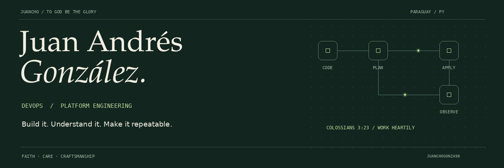
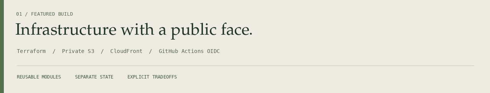

  

  <a href="https://www.linkedin.com/in/juan-andres-gonzalez-arevalos-75808a1b2/"><strong>LinkedIn</strong></a>
  &nbsp; / &nbsp;
  <a href="mailto:juanandresgonza98@gmail.com"><strong>Email</strong></a>
  &nbsp; / &nbsp;
  <a href="https://github.com/JuanchoGonza98/terraform-s3-portfolio"><strong>Featured project</strong></a>
  &nbsp; / &nbsp;
  <a href="assets/profile-banner.png">Static banner</a>

 

### A little about the engineer

I'm **Juancho**, a DevOps Engineer based in Paraguay. I work with Kubernetes platforms, Linux systems, and infrastructure automation. My backend experience helps me connect application development with the systems that run it.

I enjoy the moment when a complex system starts making sense: a deployment becomes repeatable, a failure has an explanation, or a runbook helps someone solve the next incident.

Here I share projects with enough context to explore **what I built, how it works, and why I made each decision**.

 

### Faith at the heart of my work

**To God be the glory.** My faith in Jesus Christ is part of who I am and how I want to work: with diligence, integrity, humility, and care for the people who depend on what I build.

I seek to honor Him in the work I do, the things I learn, and the knowledge I share.

Read the verse as text

> And whatsoever ye do, do it heartily, as to the Lord, and not unto men;
>
> **Colossians 3:23 — King James Version (KJV)**

 

## 01 / Selected work

### [Terraform S3 Portfolio](https://github.com/JuanchoGonza98/terraform-s3-portfolio)

A working AWS website with a private S3 origin, CloudFront delivery, and a manual deployment workflow using temporary AWS credentials.

| Build | Understand | Reproduce |
| --- | --- | --- |
| Reusable Terraform module, website objects, and environment metadata | OAC access boundaries, independent state keys, and explicit cost assumptions | Saved plans, manual apply, setup instructions, verification evidence, and cleanup guidance |

**Start exploring:** [Architecture](https://github.com/JuanchoGonza98/terraform-s3-portfolio#architecture) · [Security decisions](https://github.com/JuanchoGonza98/terraform-s3-portfolio/blob/main/SECURITY.md) · [Workflow runs](https://github.com/JuanchoGonza98/terraform-s3-portfolio/actions)

<strong>A useful detail about the environments</strong>

DEV includes CloudFront and the private S3 origin. HML demonstrates separate S3 resources and state. Its deployment predates the CloudFront addition to the shared root configuration, so a new HML plan may propose additional resources. The README explains this boundary.

 

<table>
  <tr>
    <td width="50%" valign="top">
      <h3><a href="https://github.com/JuanchoGonza98/devops-python-microservices-platform">Python Microservices Platform</a></h3>
      
Connecting backend development, container delivery, and Kubernetes deployment.

      
<strong>Explore:</strong> FastAPI services, an Nginx gateway, Docker, Kustomize overlays, GitHub Actions, GHCR, and Argo CD.

      
APPLICATIONS / CONTAINERS / GITOPS

    </td>
    <td width="50%" valign="top">
      <h3><a href="https://github.com/JuanchoGonza98/kvm-k8s-opentofu-ansible">OpenTofu / KVM Lab</a></h3>
      
Turning lab infrastructure into a repeatable environment for platform experimentation.

      
<strong>Explore:</strong> infrastructure provisioning with OpenTofu, libvirt/KVM, and cloud-init.

      
INFRASTRUCTURE / LINUX / REPRODUCIBILITY

    </td>
  </tr>
</table>

**Also contributed to:** [Django CMS](https://github.com/Elias-Gill/django_cms), a Django and PostgreSQL application, through CI/CD, Docker, DevOps practices, and application development.

 

## 02 / How I think about the work

| Principle | What it means in practice |
| --- | --- |
| **Understand the system** | Follow the request path, dependencies, identities, and state before changing the configuration. |
| **Use evidence** | Troubleshoot through logs, configuration, and checks that others can repeat. |
| **Make changes reviewable** | Keep infrastructure and deployment behavior in code, with clear plans and boundaries. |
| **Explain the tradeoffs** | Describe the scope, costs, security decisions, and operational limitations. |
| **Leave useful documentation** | Write the README and runbook that I would want to find when returning to a system. |

 

## 03 / My technical landscape

**Platforms**  
Kubernetes · VMware Tanzu · vSphere · Docker · libvirt/KVM

**Infrastructure & delivery**  
Terraform · OpenTofu · Ansible · GitHub Actions · Argo CD · GitOps

**Systems & backend**  
Linux · Python · FastAPI · Django · Nginx · PostgreSQL

 

## 04 / Learning, with a direction

<table>
  <tr>
    <td valign="top" width="50%">
      <h4>Earned</h4>
      
VMware Certified Tanzu Kubernetes Operator

    </td>
    <td valign="top" width="50%">
      <h4>Preparing</h4>
      
Terraform Associate Certified Kubernetes Administrator (CKA)

    </td>
  </tr>
</table>

Also on my learning path: **VMware Cloud Foundation / VKS administration** and **RHCSA**.

I use hands-on projects to connect the syllabus to practical decisions: who owns the state, how access is granted, what a deployment changes, and how to troubleshoot it.

 

---

  <strong>To God be the glory. In every season, in every line of work.</strong> 
  JUAN ANDRÉS GONZÁLEZ / PARAGUAY / COLOSSIANS 3:23

