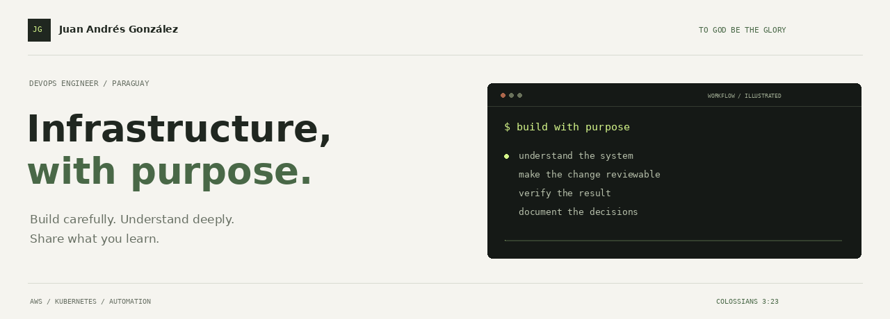
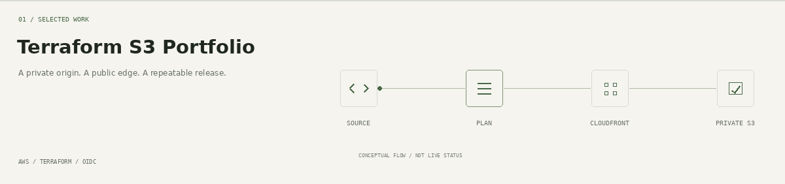
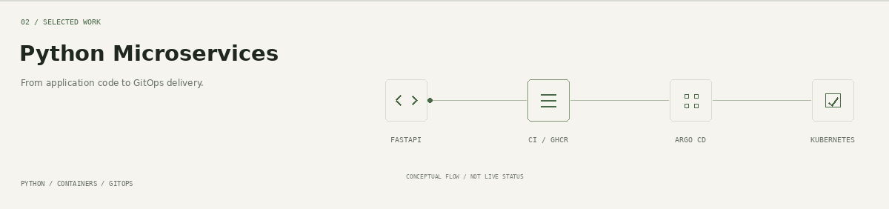
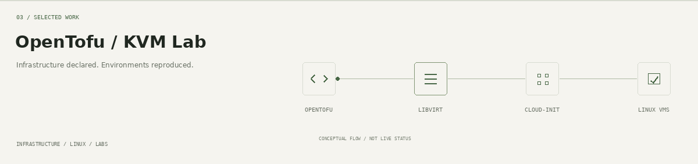
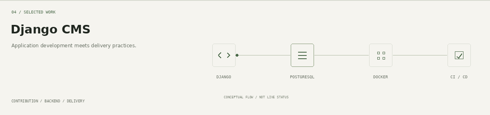

  

  <a href="https://www.linkedin.com/in/juan-andres-gonzalez-arevalos-75808a1b2/">LinkedIn</a>
  &nbsp; / &nbsp;
  <a href="mailto:juanandresgonza98@gmail.com">Email</a>
  &nbsp; / &nbsp;
  <a href="#selected-work">Selected work</a>
  &nbsp; / &nbsp;
  <a href="README.md">View animated version</a>

 

### The engineer behind the work

I'm **Juancho**, a DevOps Engineer based in Paraguay. I work with Kubernetes platforms, Linux systems, and infrastructure automation. My backend experience helps me connect how applications are developed with how they run.

I enjoy understanding a system deeply enough to explain it: following the request path, investigating a failure, making a deployment repeatable, and leaving useful documentation for the next person.

**My faith in Jesus Christ is part of who I am.** I seek to honor God through diligence, integrity, humility, and care in the work I do and the knowledge I share.

  

Read Colossians 3:23 as text

> And whatsoever ye do, do it heartily, as to the Lord, and not unto men;
>
> **Colossians 3:23 — King James Version (KJV)**

 

## Selected work

The animations below are conceptual illustrations. Project documentation provides the deployment details and verification evidence.

### [Terraform S3 Portfolio](https://github.com/JuanchoGonza98/terraform-s3-portfolio)

A working static website on AWS with a private S3 origin, CloudFront, and a manual GitHub Actions workflow using OIDC.

**What I practiced:** reusable Terraform modules, `for_each`, templates, separate DEV/HML state keys, native S3 locking, saved plans, and explicit manual apply.

**What I documented:** access boundaries, accepted security findings, usage-based cost assumptions, verification evidence, and cleanup procedures.

[Architecture](https://github.com/JuanchoGonza98/terraform-s3-portfolio#architecture) · [Security decisions](https://github.com/JuanchoGonza98/terraform-s3-portfolio/blob/main/SECURITY.md) · [Workflow runs](https://github.com/JuanchoGonza98/terraform-s3-portfolio/actions)

Environment scope

DEV includes CloudFront and its private S3 origin. HML demonstrates separate S3 resources and state. Its deployment predates the CloudFront addition to the shared root configuration; a new HML plan can propose additional resources. The project README documents this boundary.

 

### [Python Microservices Platform](https://github.com/JuanchoGonza98/devops-python-microservices-platform)

A FastAPI-based project connecting application development with container delivery and Kubernetes deployments.

**Explore:** an Nginx gateway, Docker workflows, Kubernetes manifests, Kustomize overlays, GitHub Actions CI, GHCR image publishing, and Argo CD-based GitOps delivery.

**The connection that interests me:** how application code, container images, deployment configuration, and reconciliation fit together.

 

### [OpenTofu / KVM Lab Automation](https://github.com/JuanchoGonza98/kvm-k8s-opentofu-ansible)

Infrastructure provisioning with OpenTofu, libvirt/KVM, and cloud-init for repeatable lab environments and platform testing.

**Explore:** how a declared configuration becomes a reproducible environment for learning, experimentation, and troubleshooting.

 

### [Django CMS — Contribution](https://github.com/Elias-Gill/django_cms)

Contributed to a content management system built with Django and PostgreSQL, working on CI/CD, Docker, DevOps practices, and application development.

**The perspective it adds:** understanding the application alongside its infrastructure and delivery workflow.

 

## How I approach the work

| Principle | In practice |
| --- | --- |
| **Understand the system** | Follow dependencies, request paths, identities, and state before changing configuration. |
| **Troubleshoot with evidence** | Use logs, configuration, and reproducible checks to narrow down a failure. |
| **Make changes reviewable** | Keep infrastructure and delivery behavior in code, with clear plans and boundaries. |
| **Explain the decisions** | Document scope, operational limits, security tradeoffs, and cost assumptions. |
| **Share what I learn** | Write the README and runbook I would want to find when returning to a system. |

 

## Technical landscape

| Platforms | Infrastructure & delivery | Systems & backend |
| --- | --- | --- |
| Kubernetes | Terraform / OpenTofu | Linux |
| VMware Tanzu | Ansible | Python |
| vSphere | GitHub Actions | FastAPI / Django |
| Docker / libvirt / KVM | Argo CD / GitOps | Nginx / PostgreSQL |

 

## Learning with a direction

**Earned** — VMware Certified Tanzu Kubernetes Operator.

**Preparing** — Terraform Associate and Certified Kubernetes Administrator (CKA).

**Also on my learning path** — VMware Cloud Foundation / VKS administration and RHCSA.

I use hands-on projects to connect study with practical questions: who owns the state, how access is granted, what a deployment changes, and how to troubleshoot it.

 

---

  <strong>To God be the glory.</strong> 
  JUAN ANDRÉS GONZÁLEZ / PARAGUAY / COLOSSIANS 3:23

